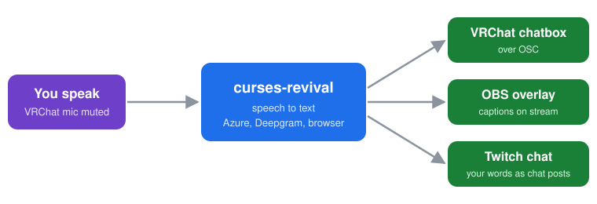

# curses-revival

Speech-to-text captions for VRChat, OBS and Twitch chat. You talk, and your words show up as a chatbox message, a stream overlay and a chat post. Made for streamers who play in VR with their VRChat mic muted.

**[Download the latest release](../../releases/latest)** · Windows 10 and 11 · [What's new](CHANGELOG.md) · [Setup guides](#setup-guides)



> **Fork notice.** This is a modified version of [curses by mmpneo](https://github.com/mmpneo/curses). It was modified starting November 2026. It stays licensed under the GNU AGPL-3.0 (see [LICENSE.md](LICENSE.md)). It is not affiliated with or endorsed by the original author.

Current version: **0.1.4**. It is still young and tested by a small group, so please [report problems](../../issues/new/choose).

## Two builds

| Build | What it is | Pick it if |
|---|---|---|
| **fixes** | The original program plus bug fixes, plus an error log file. | You want the original program, only more stable. |
| **beta** | Everything in fixes, plus new features first (see below). May have more bugs. | You want the new features early. |

If you are not sure, take **fixes** (the release marked "Latest"). Take **beta** if you need one of its features, for example Twitch login with your own Client ID. You can change later, but see [Troubleshooting](docs/troubleshooting.md) first: some beta-only settings can be lost when you go back to fixes.

## Download

- **Releases page** (best): [Releases](../../releases). Each version has two releases, for example `v0.1.4-beta` and `v0.1.4-fixes` (up to 0.1.3 the beta build was called `-features`). Files are called `curses-revival-<tag>.exe` (the program) and `curses-revival-<tag>.msi` (an installer).
- **Actions page** (newest, for testers): open the latest successful run on the [Actions](../../actions) page and download the artifact `curses-fixes` or `curses-beta`. These downloads expire after a while.

Windows may show a "SmartScreen" warning because the program is not signed. See [Troubleshooting](docs/troubleshooting.md).

## What it does

From the original program:

- **Speech to text** from your microphone. Services: Native, Browser (Chrome or Edge), Azure and Deepgram.
- **Captions overlay for OBS.** Colors, fonts, shadows, backgrounds, typing animation, sounds, particles and your own CSS.
- **OBS native stream captions.**
- **VRChat.** The chatbox, or the KillFrenzy avatar text.
- **Twitch.** Emotes (7TV, FFZ, BTTV) in captions, posting your captions in chat, and using chat messages as a text source.
- **Discord.** Post your speech to a channel.
- **Text to speech and translation.**
- **Scenes.** Several designs, with automatic switching when OBS changes scene.

## What's new in this fork

**Both builds**

- 43 of the 44 bugs found in the original are fixed (the one left is listed under Known issues in the changelog), several security holes are closed, and the app writes an error log.
- **Native speech to text works again.** It no longer fails with "network" on the first start. It starts a fresh session at a pause before Microsoft cuts it off (about every 47 seconds), so no words are lost. And it tells you when Microsoft's free daily limit (about 10 hours of speech) is used up.
- The browser speech page (Chrome or Edge) sends live text at once and starts again by itself after an error.
- The VRChat "typing..." bubble no longer gets stuck, and long messages are split properly.

**Beta build only**

- **Live text while speaking:** the VRChat chatbox fills in as you talk, instead of one big block at the end.
- **Swear and slur filter** for every speech service, including Chrome.
- **Chrome or Edge (free):** one click opens the speech window with your language set. Chrome can also run offline on your PC.
- How much of Native's free daily limit you have used, and when it starts again.
- A switch for the VRChat chatbox sound, and pausing the chatbox while you are AFK.
- Deepgram Nova-3 and Nova-2, custom words, and a sentence pause setting.
- Hotkeys, and your own Twitch Client ID typed into the app.

Full list: [CHANGELOG.md](CHANGELOG.md).

## Quick start

1. Download the `.exe` (or install the `.msi`) from [Releases](../../releases) and start it.
2. Open the **Speech to text** tab. Pick a service and fill in what it asks for (see [Speech to text](docs/speech-to-text.md)). Press **Start**.
   Not sure which service? **Native** is free and needs nothing else. **Chrome or Edge** (beta) is free too. **Deepgram** and **Azure** are the most accurate, but they need an account and are paid after a free start.
3. For VRChat: turn on OSC in the game, then open the **VRChat chatbox** tab and tick **Enable** (see [VRChat chatbox](docs/vrchat-chatbox.md)).
4. For OBS: open the **OBS Studio** tab and press **Copy browser source url**. In OBS add a Browser source and paste it (see [OBS overlay](docs/obs-overlay.md)).
5. For Twitch: open the **Twitch** tab and log in. In the beta build, paste your own Twitch Client ID first (see [Twitch](docs/twitch.md)).
6. Say something. Use **Send test** in the VRChat tab if you want to check the chatbox first.
7. If something breaks, go to **Settings** and press **Open log folder**.

## Setup guides

- [OBS overlay](docs/obs-overlay.md)
- [VRChat chatbox](docs/vrchat-chatbox.md)
- [Twitch](docs/twitch.md)
- [Speech to text](docs/speech-to-text.md)
- [Troubleshooting](docs/troubleshooting.md)

## Reporting problems

Please use the [issue form](../../issues/new/choose). Tell us which build and version you use, what you did and what happened.

Attach lines from the log file: open **Settings**, press **Open log folder**, and open `curses.log`. Tokens and keys are hidden in the log, but please look through the lines before you post them, and remove anything private.

## Contributing

Bug fixes and ideas are welcome. See [CONTRIBUTING.md](CONTRIBUTING.md) and the [code of conduct](CODE_OF_CONDUCT.md).

## Building from source

You need Windows, Node 20, pnpm 9 and Rust **1.79.0** (the version the releases are built and tested with).

```
pnpm install --frozen-lockfile
pnpm tauri build
```

The result is in `src-tauri/target/release/` (the `.exe`, and an `.msi` in `bundle/msi/`). The automatic build is described in `.github/workflows/release.yml`. Pushing a tag like `v0.1.4-beta` or `v0.1.4-fixes` makes a release.

## Credits

- [curses by mmpneo](https://github.com/mmpneo/curses): the original project and its author. All the hard work is theirs. Their support and community links are in the original repository.
- The swear and slur filter uses [profanity-list by David Sojevic](https://github.com/dsojevic/profanity-list) (MIT license).
- Thanks to everyone who tests this fork and reports problems.

## License

GNU Affero General Public License v3.0, the same as the original. See [LICENSE.md](LICENSE.md). If you give this program, or your own modified version, to other people, you must also offer them the source code, under the same license.
